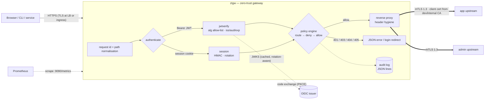
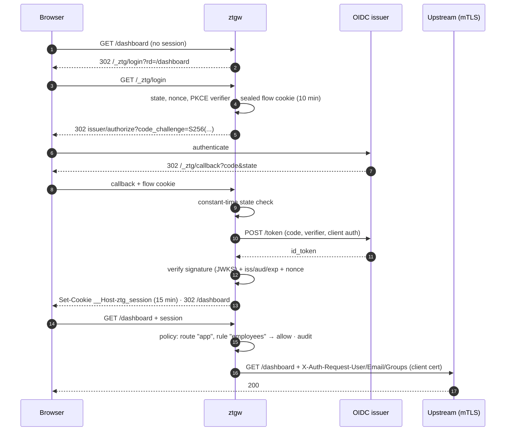

# zero-trust-gateway

[](https://github.com/HOFFMAN-ALTERNATIVE/zero-trust-gateway/actions/workflows/ci.yml)


[](LICENSE)

An **identity-aware reverse proxy** in the BeyondCorp style, written in Go with
two dependencies (`prometheus/client_golang`, `yaml.v3`). Every request is
authenticated (OIDC bearer JWT or a short-lived signed session cookie), checked
against a **deny-by-default per-route policy**, written to a JSON **audit log**,
and only then forwarded — over **mutual TLS 1.3** — to the upstream, which
receives a verified identity instead of a network location to trust.

JWT/JWKS verification, the OIDC relying party, session cookies, the policy
engine and the dev CA are implemented from the standard library, not imported,
and the whole thing is covered by integration tests that use real TLS
handshakes, a real OIDC code flow and real key rotation.

## Why

The classic perimeter model says "inside the VPN = trusted". One phished laptop
or one SSRF later, every internal dashboard is open. Zero trust moves the
decision to each request:

- **Identity, not IP.** Access depends on *who* (verified token claims), *what*
  (method + path) and *which rule* allowed it — never on where the packet came from.
- **Deny by default.** Unknown paths 404 at the gateway. Routes without allow
  rules are a config error, and so is a rule without conditions.
- **No implicit trust behind the proxy.** Upstreams only accept TLS 1.3
  connections presenting a client certificate from the gateway's CA. A
  compromised neighbour on the network can't talk to them, and can't spoof the
  identity headers either.
- **Everything observable.** One audit line per decision, Prometheus metrics for
  decisions, authn failure reasons, JWKS refreshes and upstream (mTLS) errors.

## Features

| | |
|---|---|
| Authentication | Bearer JWT (APIs/CLIs) · OIDC authorization-code flow with **PKCE S256**, state + nonce (browsers) |
| Token verification | RS256 / PS256 / ES256 / EdDSA allow-list · `none` and HS\* impossible · mandatory `kid` · `iss`/`aud`/`exp`/`nbf`/`iat` with bounded leeway · alg↔key-type pinning · `crit` rejected · invalid-curve points rejected · 8 KiB size cap |
| JWKS cache | `Cache-Control` aware · refetch on unknown `kid` (rotation) **rate-limited and single-flight** · stale-if-error · skips unusable keys |
| Sessions | HMAC-SHA256 signed cookie, 15 min default · `__Host-` prefix, `HttpOnly`, `Secure`, `SameSite=Lax` · multi-key rotation (first signs, all verify) |
| Policy (YAML) | Host + segment-aware longest-prefix routing · route method gate · `deny` before `allow` · conditions: `groups`, `subjects`, `emails`, `email_domains`, arbitrary `claims` (any-of lists), `methods`, `path_prefixes` · **hot reload on SIGHUP** (atomic swap, invalid policy rejected) |
| Upstreams | mTLS 1.3 with per-upstream CA pool and client cert · **client cert reloaded from disk** on rotation · HTTP/2 · streaming (no buffering) · `strip_prefix` · plaintext only with explicit `allow_plaintext` |
| Header hygiene | Strips inbound `X-Auth-Request-*`, `Authorization` (unless `forward_token`), gateway cookies · injects `X-Auth-Request-User/Email/Groups/Method` + `X-Request-Id` · upstreams cannot `Set-Cookie` gateway cookies |
| Request hardening | Path normalisation before policy (`/public/../admin` → `/admin`) · rejects `%2F`, `%5C`, `%00` encodings · open-redirect-safe login return URLs |
| Ops | `/healthz`, `/readyz` (JWKS loaded, not draining), `/metrics` on a separate admin port · graceful shutdown (fail readiness → drain → `Shutdown`) · distroless non-root image · built-in `-healthcheck` probe |
| Dev tooling | `devca` (ECDSA P-256 root + short-lived server/client leaves) · `mockidp` (discovery, JWKS, code+PKCE, key rotation, dev token endpoint) · two mTLS-only demo upstreams |
| Quality | `go test -race -shuffle=on` on Go 1.23/1.24/stable · 86 % coverage · golangci-lint (15 linters incl. gosec) · govulncheck · docker-compose end-to-end smoke test in CI |

## Architecture



Browser login (authorization code + PKCE):



## Quickstart

### Demo (docker compose)

```bash
docker compose up --build -d     # devca → mock issuer, 2 mTLS upstreams, gateway
./scripts/smoke.sh               # the same end-to-end walkthrough CI runs
```

Open <http://localhost:8080/> in a browser: you are redirected through the mock
issuer's persona picker and land back with a session.

| Persona | Groups | Email | `/` (app) | `/finance` | `GET /admin` | `POST /admin` |
|---|---|---|---|---|---|---|
| alice | engineering, admins | @example.com | ✅ | ❌ 403 | ✅ | ✅ |
| bob | engineering | @example.com | ✅ | ❌ 403 | ✅ | ❌ 403 |
| carol | finance | @example.org | ❌ 403 | ✅ | ❌ 403 | ❌ 403 |

API style:

```bash
TOKEN=$(curl -s 'localhost:9000/dev/token?user=bob' | jq -r .access_token)
curl -s -H "Authorization: Bearer $TOKEN" localhost:8080/hello | jq
```

```json
{
  "service": "app",
  "path": "/hello",
  "user": "u-1002",
  "email": "bob@example.com",
  "groups": "engineering",
  "authn": "bearer",
  "request_id": "Hk3f0yq7Q2m0eN1vR8sZtw",
  "mtls_peer": "gateway",
  "tls_version": "TLS 1.3"
}
```

```bash
curl -s -X POST -H "Authorization: Bearer $TOKEN" localhost:8080/admin/users   # 403, rule-based
curl -s -X POST localhost:9000/rotate                                           # rotate issuer keys
curl -s localhost:9090/metrics | grep ztg_                                      # decisions, failures, JWKS
docker compose logs gateway | grep '"log":"audit"' | jq                        # audit trail
```

Audit record:

```json
{"time":"2026-10-17T00:21:30.22+02:00","level":"INFO","event":"access","log":"audit",
 "request_id":"rHW12aSX45vIg0f9VxRELg","remote_ip":"172.18.0.1","method":"POST","host":"localhost:8080",
 "path":"/admin/users","route":"admin","decision":"deny","reason":"no allow rule matched","status":403,
 "authn":"bearer","duration_ms":0.21,"upstream":"admin","sub":"u-1002","email":"bob@example.com","groups":["engineering"]}
```

### Policy

```yaml
routes:
  - name: admin
    match: { path_prefix: /admin, methods: [GET, POST, DELETE] }   # other methods → 405
    upstream: admin
    strip_prefix: true
    deny:                                   # evaluated first; any match → 403
      - name: no-unverified-email
        claims: { email_verified: false }
    allow:                                  # at least one must match (all conditions in a rule)
      - name: admins-full-access
        groups: [admins]
      - name: engineers-read-only
        groups: [engineering]
        methods: [GET]

  - name: public
    match: { path_prefix: /public }
    upstream: app
    public: true                            # explicit, audited, no rules allowed
```

Full example: [`deploy/demo/config.yaml`](deploy/demo/config.yaml). The loader is
strict — unknown keys, rules without conditions, unknown upstreams, plaintext
upstreams without `allow_plaintext`, or session keys < 32 bytes all fail
startup (or a SIGHUP reload) with every problem listed at once.

### Running it for real

```bash
go run ./cmd/devca -out certs -servers app -clients gateway   # or your internal CA / cert-manager
export ZTG_SESSION_KEYS="k1:$(openssl rand -base64 32)"        # rotate: "k2:new,k1:old"
export ZTG_CLIENT_SECRET=...                                   # from your IdP (Keycloak, Entra ID, Okta, Google…)
go run ./cmd/ztgw -config config.yaml -audit-log /var/log/ztg/audit.jsonl
kill -HUP <pid>                                                # reload policy without dropping connections
```

Omit the three `*_endpoint`/`jwks_uri` keys and the gateway uses OIDC discovery
(the advertised `issuer` must match exactly). Terminate public TLS in front of
the gateway (LB / ingress) and set `trusted_proxy: true` only when that hop is
the sole way in.

## Threat model

Assets: upstream data and actions; session cookies; signing/session keys.
Trust anchors: the OIDC issuer's keys, the gateway's session keys, the internal CA.

| Threat | Mitigation | Tested by |
|---|---|---|
| Forged / unsigned token (`alg: none`, HS256 with the RSA public key as secret) | Fixed asymmetric alg allow-list; HS\* not even configurable; key type must match `alg`; key's own `alg` pin honoured | `TestVerifyRejections` |
| Token for another app / issuer, expired or not-yet-valid | Exact `iss`, `aud` must contain client id, `exp` mandatory, leeway capped at 5 min | `TestVerifyRejections`, `TestExpiredTokenAndMetrics` |
| Signing key rotation breaking logins | Unknown `kid` triggers JWKS refetch; previous key stays valid while published | `TestSigningKeyRotation`, `TestKeyRotationRefetchesOnUnknownKid` |
| `kid` spraying to DoS the issuer through the gateway | Unknown-kid refetch is single-flight and rate-limited (`jwks_min_refresh`) | `TestUnknownKidRefetchIsRateLimited` |
| Issuer outage | Cached keys served stale-if-error; readiness requires only the first successful fetch | `TestStaleIfError` |
| Login CSRF / code injection / code interception | `state` bound to a sealed per-browser flow cookie (constant-time compare), `nonce` checked in the ID token, PKCE S256, single-use codes | `TestCallbackRejectsForgedState`, mockidp tests |
| Open redirect after login | `rd` must be a local path; `//host`, `/\host`, absolute URLs collapse to `/` | `TestOpenRedirectPrevented` |
| Session cookie theft / tampering | HMAC-SHA256 over version+kid+payload, 15 min TTL, `__Host-`/`Secure`/`HttpOnly`/`SameSite=Lax`, never forwarded upstream | `TestTamperingIsRejected`, `TestSpoofedIdentityIsStripped` |
| Identity header spoofing (`X-Auth-Request-User: admin`) | All inbound `X-Auth-Request-*` stripped before injection | `TestSpoofedIdentityIsStripped` |
| Path tricks to escape a route (`/public/../admin`, `%2F`, `%5C`, `%00`) | Path cleaned before routing and used verbatim upstream; ambiguous encodings rejected with 400; segment-aware prefixes (`/admin` ≠ `/administrator`) | `TestAmbiguousPathsRejected`, `TestRouteSelection` |
| Lateral movement: something else on the network calls upstreams directly | Upstreams require TLS 1.3 client certs from the internal CA *and* authorise the CN; wrong CA, no cert or untrusted server cert → 502 at the gateway | `TestMutualTLSFailuresAreBadGateway` |
| Upstream overwriting gateway cookies | `Set-Cookie` for reserved names dropped in `ModifyResponse` | `TestUpstreamCannotSetGatewayCookies` |
| Misconfiguration opening everything | Deny-by-default; empty rules and allow-less routes rejected; invalid hot reload keeps the old policy | `TestValidation`, `TestPolicyHotReload` |
| Repudiation | Append-only JSON audit line per decision with subject, rule, reason, request id | `TestAuditLog` |

**Out of scope / residual risk.** Revocation is bounded by token and session
lifetime (short by design — no server-side session store to replicate). Device
posture is not evaluated (the claim matcher can consume posture claims if your
IdP issues them). Rate limiting belongs in front of or beside the gateway (see
[distributed-rate-limiter](https://github.com/HOFFMAN-ALTERNATIVE/distributed-rate-limiter)).
The mock issuer and `devca` are development tools and must never be exposed.

## Design decisions & trade-offs

- **Stdlib crypto over a JOSE library.** Verification is ~250 lines with one
  job: refuse everything except the few algorithms and shapes we expect. Large
  JOSE libraries carry JWE, `jku`/`x5u` header fetching and algorithm
  negotiation — attack surface an auth gateway does not need.
- **Stateless sessions.** An HMAC cookie scales horizontally with zero shared
  state; the price is no instant server-side revocation, which is why the TTL is
  short and policy is re-evaluated on every request (group changes apply at the
  next login, removed routes immediately).
- **Explicit `deny` + `allow` instead of a policy language (Rego/CEL).** The YAML
  covers the common BeyondCorp rules, is reviewable by non-developers and has no
  evaluation-time failure modes. 150 ns / 0 allocs per decision. A CEL backend
  could slot in behind `policy.Evaluate` if expressions become necessary.
- **Identity headers + mTLS, not token forwarding.** Upstreams trust a
  mutually-authenticated hop and plain headers; they never see bearer tokens
  (so a compromised upstream can't replay them). `forward_token: true` exists
  for upstreams that must call other APIs on the user's behalf.
- **Admin port split.** Metrics and probes listen separately so the public
  listener exposes only routed traffic and `/_ztg/*`.
- **Graceful shutdown order.** Fail `/readyz` → wait `-drain-delay` for load
  balancers to notice → `http.Server.Shutdown` with a deadline, so rolling
  deploys drop zero requests.
- **Discovery optional.** Inside container networks the browser-facing and
  back-channel URLs of the IdP differ; explicit endpoints handle that without
  DNS hacks, discovery covers the normal case.

## Performance

`go test -bench . ./internal/...` on an 8-vCPU Xeon VM (Go 1.24):

```
BenchmarkVerify/RS256-8         34.6 µs/op   4008 B/op   77 allocs/op
BenchmarkVerify/EdDSA-8         52.1 µs/op   2440 B/op   68 allocs/op
BenchmarkVerify/ES256-8         85.7 µs/op   3656 B/op   92 allocs/op
BenchmarkRouteAndEvaluate-8    149.3 ns/op      0 B/op    0 allocs/op
```

Signature verification dominates; session-cookie requests skip it entirely
(one HMAC). Policy evaluation is effectively free.

## Tests

```bash
make test     # go test -race ./...   (unit + in-process integration, real TLS)
make cover    # 86 % statement coverage across internal/...
make lint     # go vet + golangci-lint
make vuln     # govulncheck
make up && make smoke   # docker-compose end-to-end
```

| Suite | What it proves |
|---|---|
| `internal/jwtverify` | every rejection path above, all three algorithms, audience arrays, nonce, leeway, rotation, kid-spray rate limit (50 concurrent goroutines → 1 fetch), stale-if-error, malformed JWKS entries |
| `internal/session` | round trip, tampering (kid swap, foreign secret, stripped MAC), expiry, key rotation and retirement |
| `internal/policy` | routing precedence, segment matching, deny-over-allow, claim any-of / list claims, validation errors aggregated |
| `internal/gateway` | full stack in-process: mock issuer + gateway + two **real mTLS upstreams** (`httptest` + `devca`): bearer and browser code-flow logins, header spoofing, Set-Cookie filtering, path tricks, wrong-CA / missing client cert, key rotation, metrics, audit, readiness/drain, hot reload, 60 concurrent mixed decisions under `-race` |
| `internal/mockidp`, `internal/devca`, `internal/config` | PKCE enforcement, single-use codes, redirect URI allow-list, cert chains and EKUs, TLS 1.3 handshake, strict YAML |
| CI `demo` job | `docker compose up`, [`scripts/smoke.sh`](scripts/smoke.sh) (19 checks incl. browser login with `curl -L`), audit log is JSON, SIGTERM drains and exits 0 |

## Project layout

```
cmd/ztgw          gateway binary (signals, SIGHUP reload, graceful shutdown, healthcheck probe)
cmd/devca         development CA generator
cmd/mockidp       mock OIDC issuer
cmd/upstream      mTLS-only demo backend
internal/gateway  request pipeline, OIDC login/callback, upstream transports
internal/jwtverify JWT + JWKS verification
internal/oidc     relying-party code flow + PKCE + discovery
internal/policy   routing + deny-by-default rule engine
internal/session  signed session cookies
internal/audit    JSON audit log
internal/metrics  Prometheus instruments (private registry)
internal/config   strict YAML + env secrets
internal/jose     minimal JWS signer for the mock issuer and tests
deploy/demo       demo policy
```

## License

[MIT](LICENSE) © 2026 Herman Hoffman
